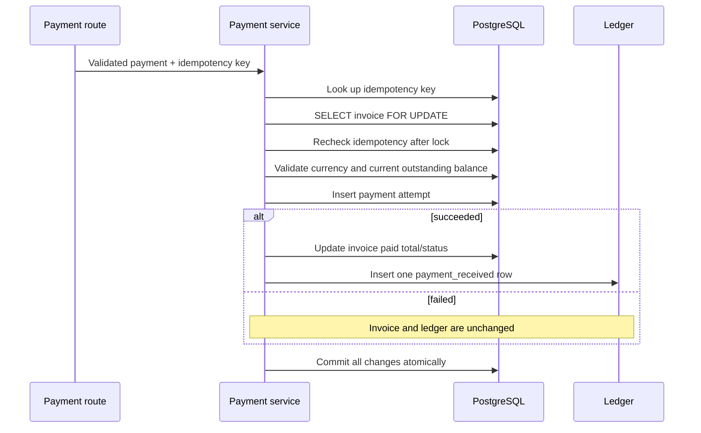

# SubLedger — Design

## 1. High-level architecture

```text
HTTP request
    ↓
FastAPI route → Pydantic schema validation
    ↓
Service (business rules and transaction boundary)
    ↓
Repository (SQLAlchemy reads/writes; no commits)
    ↓
SQLAlchemy model → PostgreSQL
```

`app/core/config.py` owns environment-backed configuration.
`app/db/session.py` owns the SQLAlchemy engine, declarative base, and request
session lifecycle. The layers are deliberately separate so HTTP concerns,
business rules, and persistence queries can evolve independently.

## 2. Layer responsibilities

- **Routes:** HTTP methods/paths, query/path validation, dependency injection,
  response schemas, and status codes.
- **Schemas:** Pydantic v2 request validation and response serialization;
  schemas are not ORM entities.
- **Services:** application workflows, business validation, and transaction
  commit/rollback ownership.
- **Repositories:** model queries and inserts/flushes. They do not commit.
- **Models:** table mappings, foreign keys, checks, indexes, relationships,
  and ORM-level ledger immutability.
- **Database/configuration:** engine settings and per-request session cleanup.
- **Alembic:** additive schema evolution. The migration does not drop existing
  billing records.

## 3. Entity relationship diagram

```mermaid
erDiagram
    CUSTOMER ||--o{ SUBSCRIPTION : owns
    PLAN ||--o{ SUBSCRIPTION : selected_by
    CUSTOMER ||--o{ INVOICE : billed
    SUBSCRIPTION ||--o{ INVOICE : generates
    INVOICE ||--o{ PAYMENT_ATTEMPT : receives
    CUSTOMER ||--o{ LEDGER_ENTRY : owns
    INVOICE o|--o{ LEDGER_ENTRY : records

    CUSTOMER {
        int id PK
        string name
        string email UK_normalized
        datetime created_at
    }
    PLAN {
        int id PK
        string name
        decimal price
        string currency
        string billing_interval
        boolean is_active
        datetime created_at
    }
    SUBSCRIPTION {
        int id PK
        int customer_id FK
        int plan_id FK
        string status
        datetime current_period_start
        datetime current_period_end
        datetime created_at
    }
    INVOICE {
        int id PK
        int subscription_id FK
        int customer_id FK
        decimal amount_due
        decimal amount_paid
        string currency
        string status
        datetime period_start
        datetime period_end
        datetime due_date
        datetime created_at
    }
    PAYMENT_ATTEMPT {
        int id PK
        int invoice_id FK
        decimal amount
        string currency
        string status
        string provider_reference
        string idempotency_key UK
        string failure_reason
        datetime created_at
    }
    LEDGER_ENTRY {
        int id PK
        int customer_id FK
        int invoice_id FK_nullable
        string entry_type
        decimal amount
        string currency
        string reference_id UK
        datetime created_at
    }
```

## 4. Entity and table design

- **Customer (`customers`):** unique normalized email, customer name, and
  creation timestamp.
- **Plan (`plans`):** price is `NUMERIC(12, 2)` / Python `Decimal`; price has
  a database positive-value check. Currency is stored as a three-character
  code.
- **Subscription (`subscriptions`):** restrict-delete references to customer
  and plan; database check requires end after start. A partial unique index
  prevents two active rows for the same customer/plan pair.
- **Invoice (`invoices`):** amount due, currency, and customer are snapshots
  at generation time. Database checks protect amount and billing-period
  bounds. A unique index prevents duplicate subscription billing periods.
- **Payment attempt (`payment_attempts`):** every processing request is
  preserved, including failed attempts. A unique idempotency key and positive
  amount check are enforced by the database.
- **Ledger entry (`ledger_entries`):** append-only financial record with unique
  reference ID and restrict-delete foreign keys.

Foreign-key relationships use `RESTRICT` to avoid deleting customers, plans,
subscriptions, invoices, or ledger history still referenced by billing
records.

## 5. Business-rule ownership

| Rule | Primary owner | Database backstop |
|---|---|---|
| Positive plan/payment amounts | Pydantic schema and service | Check constraints |
| Normalized unique customer email | Customer service | Unique lower(email) index |
| Existing customer and active plan | Subscription service | Foreign keys and partial unique index |
| Active duplicate subscription prevention | Subscription service | Partial unique index |
| Valid billing periods | Request schema/service | Check constraints |
| Invoice price/currency snapshot | Invoice service | Stored invoice columns |
| Unique subscription invoice period | Invoice service | Unique composite index |
| Payment balance and currency | Payment service | Invoice amount checks |
| Payment idempotency | Payment service | Unique idempotency key |
| Successful payment ledger event | Payment service | Unique ledger reference and transaction |
| Ledger immutability | ORM event and PostgreSQL trigger | Trigger rejects UPDATE/DELETE |

## 6. Subscription workflow

1. Validate positive customer and plan IDs, timezone-aware billing timestamps,
   and end-after-start.
2. Load customer and plan; return `404` if either is missing.
3. Reject an inactive plan and an already-active customer/plan subscription.
4. Insert and commit the subscription.
5. The partial unique database index is the final guard against concurrent
   duplicate creation.

## 7. Invoice generation workflow

1. Load the subscription and require `active` status.
2. Convert the request's date boundaries to UTC midnight timestamps and
   validate the period.
3. Reject an existing subscription/period invoice.
4. Copy the subscription customer and current plan price/currency into the
   invoice.
5. Insert and commit. The unique composite index resolves concurrent duplicate
   generation attempts as a conflict.

Later plan edits cannot change persisted invoice amount or currency.

## 8. Payment workflow, transaction, and concurrency



The service owns the transaction. Repositories call `flush()` to obtain IDs but
never commit. Any failure rolls the transaction back, including payment,
invoice, and ledger changes.

The invoice query uses SQLAlchemy `with_for_update()`, which maps to
PostgreSQL `SELECT ... FOR UPDATE`. Concurrent requests serialize on that
invoice row; each request reads the current amount paid only after acquiring
the lock. Therefore, a second successful payment that would overpay is
rejected.

SQLite does not provide equivalent row-locking guarantees. SQLite unit tests
validate functional behavior and rollback only; PostgreSQL integration
coverage is opt-in and must use a dedicated `_test` database.

## 9. Idempotency design

1. Look up the idempotency key before processing. A matching request returns
   the original payment attempt.
2. Lock the target invoice, then look up the key again. This closes the same
   invoice request race.
3. Insert the attempt inside a nested transaction/savepoint. The unique key
   constraint handles simultaneous uses against different invoices.
4. On a uniqueness race, read the winner and replay only if invoice, amount,
   currency, status, provider reference, and failure reason match. Otherwise,
   return `409 Conflict`.

All payment inputs used for equality are normalized or validated by the
request schema. Idempotency is permanent for the lifetime of the payment
attempt; key expiry is not currently implemented.

## 10. Ledger design and immutability

Each successful payment creates one `payment_received` entry whose unique
reference is derived from the payment attempt ID. Failed attempts never create
such an entry. Both writes occur in the same transaction.

There are no public update/delete endpoints. SQLAlchemy ORM events reject
attempted updates/deletes, and the PostgreSQL migration adds a trigger that
rejects direct SQL `UPDATE` and `DELETE` as well. This is application-level
integrity protection, not tamper-proof storage against a database owner who
can alter triggers or tables.

## 11. API design decisions

- All domain operations are under `/api/v1`; health remains at `/health`.
- Create operations return `201`; validation failures return `422`, missing
  resources `404`, and business/uniqueness conflicts `409`.
- Collection responses use bounded `limit`/`offset` pagination.
- Invoice, payment, and ledger collections expose filters appropriate to
  their domain.
- Response schemas use `from_attributes=True`; ORM models are not returned as
  uncontrolled public objects.
- The simulated payment API accepts `succeeded` or `failed` from the client
  for assignment testing only. Real deployments must verify provider outcomes
  via authenticated gateway webhooks/callbacks.

## 12. Patterns, trade-offs, and limitations

- **Repository pattern:** isolates SQLAlchemy query construction.
- **Service layer / Unit of Work:** keeps domain workflows and commits
  explicit.
- **Dependency injection:** provides request-scoped sessions and test
  overrides.
- **Database constraints plus service validation:** provides clear client
  errors while protecting invariants against concurrent requests.

Authentication/authorization, real provider processing, webhook signature
verification, recurring billing scheduling, refunds, tax rules, retries,
currency-specific scale, and operational metrics are beyond the current
assignment scope. Currency values are syntactically three-letter codes; the
service does not currently validate them against an external currency
registry.
